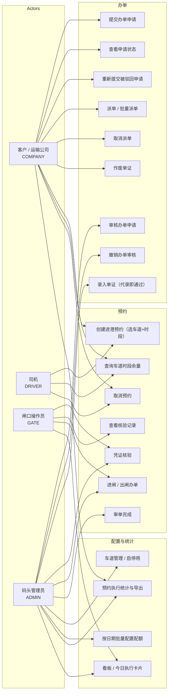
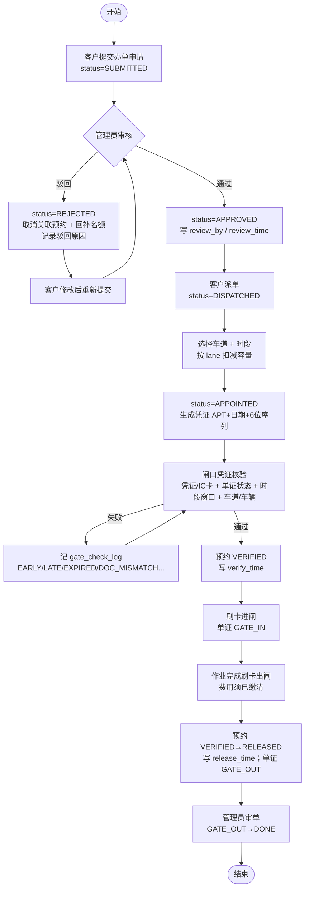
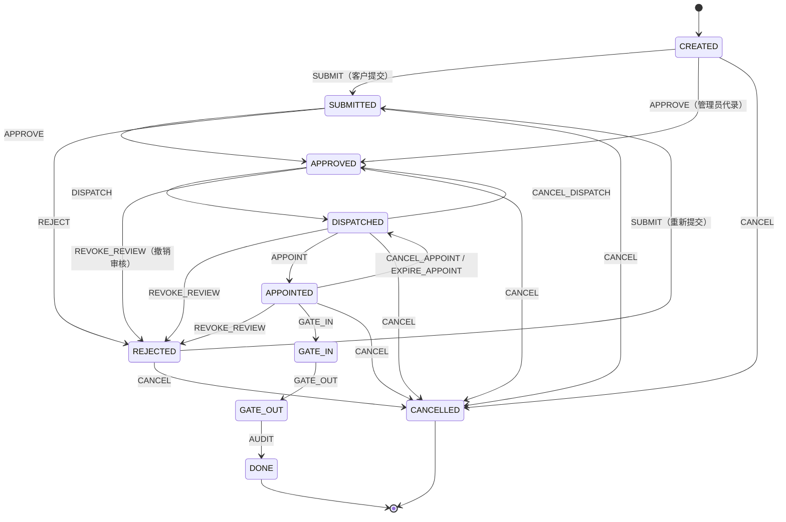
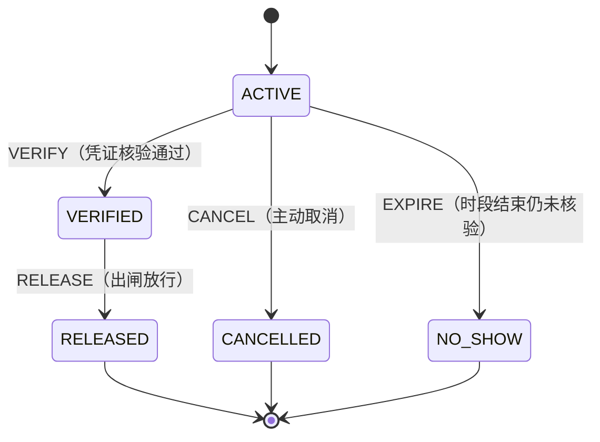

# 用例图、核心流程图与状态图（Mermaid）

> 文本格式，可直接在支持 Mermaid 的 Markdown 查看器（VS Code / GitLab / Typora）中渲染，也便于版本管理。
> 与 `系统设计说明.md` 附录 B 的状态机、M1–M4 口径保持一致。

## 一、用例图

## 二、核心流程图：办单申请 → 审核 → 派单 → 预约 → 核验 → 进出闸

## 三、状态图

### EIR 单证

### 预约

## 四、说明

- 「失约」只可能从 ACTIVE 经 EXPIRE 进入；已核验（VERIFIED）的预约不会再被标失约
- 取消是主动行为，统计的失约率分母已排除取消
- 撤销审核（REVOKE_REVIEW）是审核通过后的唯一回退路径，会级联取消预约并回补名额